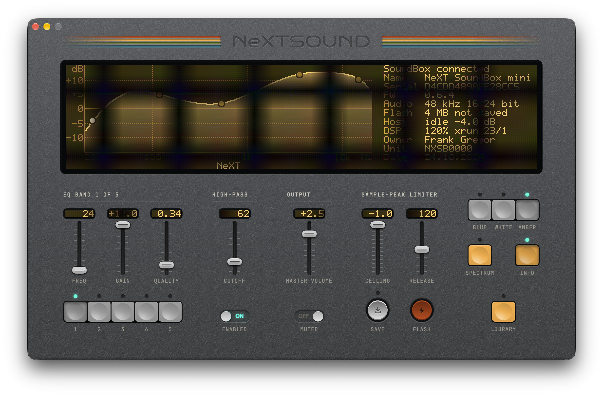

<div align="center">

[](https://github.com/phranck/NeXTsound/releases)
[](https://github.com/phranck/NeXTsound/actions/workflows/checks.yml)
[](https://github.com/phranck/NeXTsound/commits/main)
[](https://github.com/phranck/NeXTsound/issues)
[](https://github.com/phranck/NeXTsound)
[](https://github.com/phranck/NeXTsound)



</div>

# NeXTsound

NeXTsound tunes the NeXT SoundBox mini, a small desktop speaker that plays from a Mac over USB. The repository holds both halves of it: the firmware that turns an RP2350 board into the speaker's USB sound card and signal processor, and a native Mac app that edits how the speaker sounds while it plays.

## What it does

- **Sound profiles.** A profile holds five EQ bands, a high-pass, the master volume and a sample-peak limiter. The app keeps a library of profiles, and every edit plays on the connected SoundBox at once.
- **The board's own memory.** The SAVE button stores the current profile on the board, so it plays that way on any computer, without the app.
- **Live spectrum.** The display shows the spectrum of what the SoundBox plays, computed from the audio the Mac sends to it and the profile's processing.
- **Profile files.** Profiles export as `.nxsbprofile` files, and a double-click in the Finder imports one and plays it.
- **Firmware updates.** The app brings the firmware that matches it and flashes it onto the board.

## Hardware

The SoundBox is built around a Waveshare RP2350-Zero-M board and a MAX98357A I2S amplifier. The firmware presents the board to the Mac as a 48 kHz stereo USB audio device, averages the two channels to mono, runs the result through the profile's processing, and sends it to the amplifier. The enclosure and its circuit board are separate projects.

The firmware is a private bench build, not a hardware-qualified release. A successful build or test does not establish board compatibility, audio timing, amplifier behavior or speaker safety.

## Requirements

- A Mac with Apple silicon and macOS 26 or later.
- To build: the Xcode version that [`toolchain.json`](toolchain.json) pins, and Homebrew's `libusb`, `cmake`, `ninja` and `jq`. The scripts fetch every other tool, including the ARM compiler and the Pico SDK, at pinned versions into `.tools`.

```bash
brew install libusb cmake ninja jq
```

## Building

The app, with the firmware it brings along:

```bash
bash Scripts/app.sh
```

The Release app lands in `.build/macOS/Build/Products/Release/NeXTsound.app`. The script builds the firmware first, because the app bundles it.

The firmware on its own:

```bash
bash Scripts/firmware.sh
```

The complete check, with every test, the formatter, the linter and all builds:

```bash
bash Scripts/check.sh
```

None of these scripts touches a connected board. Flashing happens only from the app.

## Documentation

- [The Mac app](Documentation/App.md): the front panel, the libraries, board discovery, flashing and the build.
- [The firmware](Documentation/Firmware.md): the RP2350 targets, USB audio and the control interface.
- [The signal processing](Documentation/DSP.md): the mono DSP engine that the firmware and the app share.
- [The control protocol](Documentation/Protocol.md): the reports the app and the board exchange, and the sound profile format.
- [Persistent storage](Documentation/Storage.md): how the board saves its settings and recovers them.
- [Backup](Documentation/Backup.md): identifying a board's flash and preserving it before new firmware goes on.
